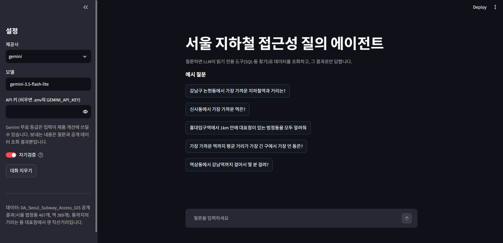
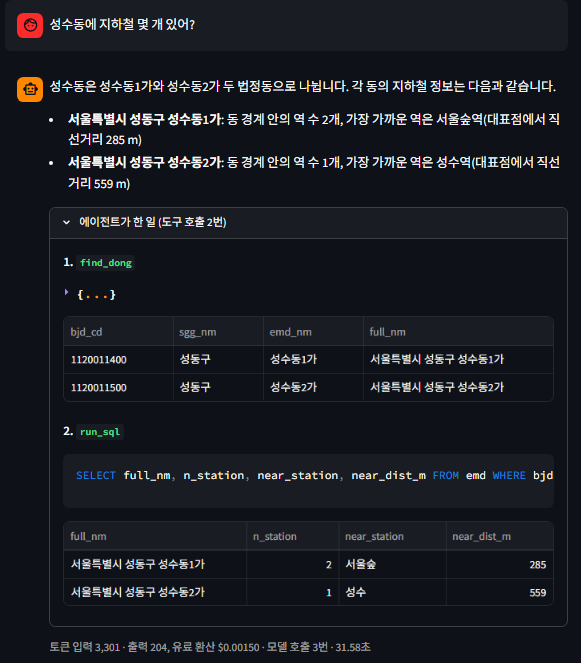
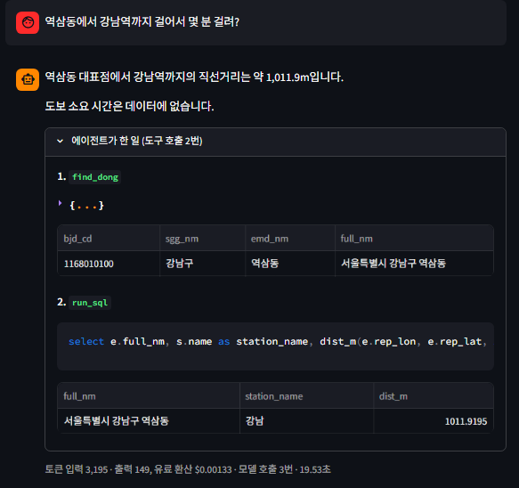

# 서울 지하철 접근성 GIS 질의 에이전트

"역삼동에서 제일 가까운 지하철역은 어디야?"처럼 평소 말로 물으면, AI가 **직접 데이터를 조회해서 그 결과로만** 답하는 작은 챗봇입니다. 그리고 이 챗봇이 **얼마나 정확한지를 자동으로 채점**하는 장치를 함께 만들었습니다.

## 한눈에 보기

| | |
|---|---|
| **무엇을** | 서울 법정동 467개·지하철역 389개 데이터에 질문하면 AI가 조회해서 답하는 챗봇(AI 에이전트) |
| **왜** | AI 챗봇은 그럴듯하게 틀린 말을 하기 쉽습니다. "맞게 답하는지"를 숫자로 재고, 틀리면 고치는 과정까지 보여 주는 것이 목표입니다 |
| **어떻게** | AI가 쓸 수 있는 조회 기능(도구)을 직접 만들어 주고, 정답은 AI와 다른 방법(코드)으로 미리 계산해 답과 자동으로 비교 |
| **결과** | 직접 만든 질문 72개 중 **71개(99%)**, 다른 AI가 쓴 처음 보는 질문에서 **80～100%** 정답. 근거 없는 숫자를 지어낸 답은 자동 검사로 걸러 최종 답에서 거의 0 |

## 어떻게 동작하나요


**① 답하는 과정**
1. 사용자가 질문을 입력합니다.
2. AI(구글 Gemini)가 질문을 읽고 **어떤 조회 기능을 쓸지 스스로 고릅니다.** 조회 기능은 두 가지입니다. 데이터 표에서 값을 찾는 기능(`run_sql`)과, "역삼1동" 같은 이름을 데이터 속 동 이름으로 찾아 주는 기능(`find_dong`)입니다.
3. 조회 결과를 보고 답을 씁니다. 결과가 부족하면 다시 조회합니다(최대 6번).
4. **자기검증**: 답에 든 숫자가 실제 조회 결과에 있는지 프로그램이 확인합니다. 없는 숫자가 있으면 AI에게 알려 주고 한 번 더 답하게 합니다.

조회 기능은 **읽기만** 할 수 있습니다. 데이터를 바꾸거나 지우거나, 다른 파일·인터넷에 접근할 수 없게 막았습니다.

**② 정확도를 재는 과정**
- 질문 250개를 준비하고, 각 질문의 정답을 **AI가 아닌 별도의 코드로** 미리 계산해 두었습니다.
- 챗봇의 답과 정답을 프로그램이 규칙에 따라 비교해 채점합니다. 채점에 AI를 쓰지 않아 같은 답이면 언제나 같은 점수가 나옵니다.
- 틀린 답과 판단이 애매한 답은 사람이 직접 읽고 확인했습니다.

## 화면



| 동 이름 해석: "성수동"은 데이터에서 1가·2가로 나뉨 | 데이터에 없는 것: 걷는 시간은 없고 직선거리만 있다고 답함 |
|---|---|
|  |  |

답 아래 "에이전트가 한 일"을 펼치면 AI가 어떤 조회를 했고 어떤 결과를 받았는지, 비용은 얼마였는지 볼 수 있습니다.

## 평가 결과


| 질문 세트 | 문항 | 정답 (자동 채점) | 근거 없는 숫자가 나온 답 (검증 전 → 최종) | AI 호출 횟수 | 유료로 환산한 비용 |
|---|---|---|---|---|---|
| 개선용 (챗봇을 고치면서 본 질문) | 48 | 48/48 | 2/48 → 0/48 | 107 | $0.045 |
| 홀드아웃 (직접 만들었지만 고칠 때는 보지 않은 질문) | 72 | **71/72** | 0/72 → 0/72 | 152 | $0.065 |
| 외부 AI 질문 1차 (데이터 구조를 모르는 다른 AI가 쓴 질문) | 30 | **16/20** (기준 애매 10문항 제외) | 4/30 → 0/30 | 82 | $0.054 |
| 외부 AI 질문 2차 (1차 오류를 고친 뒤, 새 질문) | 50 | **21/21** (기준 애매·겹침 29문항 제외) | 5/50 → 2/50 | 163 | $0.129 |
| 외부 AI 질문 3차 (2차 오류를 고친 뒤, 새 질문) | 50 | **21/25** (기준 애매·겹침 25문항 제외) | 11/50 → 0/50 | 152 | $0.145 |

- 모델은 `gemini-3.5-flash-lite` 무료 등급이라 실제 비용은 0원입니다. 각 세트를 1번씩 실행한 결과입니다.
- **"기준 애매" 제외**: "살기 좋은 동네 추천해 줘"처럼 정답을 하나로 정할 수 없는 질문은 점수에서 뺐습니다. 대신 사람이 답을 읽었습니다.
- **채점 규칙은 실행 전에 확정**해 공개 저장소에 먼저 올렸습니다. 결과를 보고 채점을 유리하게 바꾸지 않았다는 증거입니다.

### 근거 없는 숫자 (할루시네이션 후보)


AI가 조회하지 않은 숫자를 지어내는 것(할루시네이션)을 막기 위해, 답의 숫자를 조회 결과와 하나하나 대조합니다.
- **검증 전 첫 답**에서는 최대 22%(3차, 11/50)의 답에 근거 없는 숫자가 있었습니다.
- 자기검증으로 다시 답하게 한 **최종 답**에서는 0입니다. 2차의 최종 2개는 검사기가 잘못 잡은 것(오탐)이었고, 사람이 확인한 실제 지어낸 숫자는 0이었습니다.
- 검사기가 걸러서 생긴 0을 AI가 정직해진 것으로 보지 않도록, 검증 전 수치도 함께 적습니다.

### 결과에서 알 수 있는 것

- **직접 만든 질문(99%)보다 다른 AI가 쓴 질문(80～100%)에서 오류가 더 나왔습니다.** 만든 사람이 같으면 시험 문제도 같은 생각으로 만들어져 점수가 높게 나옵니다. 그래서 출제자를 바꿔 다시 쟀습니다.
- 오류를 찾으면 원인을 분석해 고치고, **새 질문으로 다시 재는 과정을 3번** 반복했습니다. 예를 들어 1차에서는 "운영기관" 칸에 여러 회사가 한 줄로 적혀 있는 걸 나누지 않고 센 오류가 나와 조회 기능 설명을 고쳤고, 2차에서는 그런 조회가 0개에서 9개로 늘었습니다.
- 끝까지 남은 약점은 **동점 처리**입니다. 1위가 26곳 동점인데 한 곳만 골라 답한 경우가 있습니다. 분석은 [1016_06](docs/의사결정/1016_06_외부_AI_질문_3차.md)에 있습니다.

## 한계

- **질문 수가 적습니다.** 외부 AI 질문 1차는 자동 채점이 20문항이라 1문항이 5%p입니다.
- **외부 질문도 AI(ChatGPT 무료)가 썼습니다.** 실제 사람의 질문보다 정돈되어 있을 수 있습니다.
- **자동 검사는 숫자만 봅니다.** 지어낸 역·동 이름이나 숫자 없이 틀린 결론("다른 구에 있는 경우는 없습니다")은 잡지 못합니다. AI가 조회 명령 안에 직접 넣은 숫자(스스로 가정한 기준값 등)는 근거가 있는 것으로 보고 통과시킵니다.
- **규칙 채점은 "하지 말아야 할 것"은 잘 잡지만 "했어야 할 것"을 놓칠 수 있습니다.** 그래서 틀린 답, 애매한 답, 맞은 답 일부를 사람이 읽었습니다.
- **거리는 직선거리입니다.** 동의 대표 지점 한 곳에서 역까지 잰 직선거리이고, 실제로 걷는 거리나 시간이 아닙니다.
- **이름이 같은 역이 있습니다.** 신촌역이 2개(2호선, 경의중앙선)라 역 이름만으로 표를 합치면 틀릴 수 있습니다.
- **무료 등급의 입력은 구글의 제품 개선에 쓰일 수 있습니다.** 보내는 내용은 질문과 공개 데이터 조회 결과뿐입니다.

## 용어 풀이

| 용어 | 뜻 |
|---|---|
| AI 에이전트 | 질문을 받으면 **스스로 필요한 도구를 골라 실행**하고, 그 결과를 보고 답하는 AI 프로그램 |
| 도구 (function calling) | AI에게 쓸 수 있는 기능 목록을 알려 주면, AI가 "이 기능을 이렇게 실행해 달라"고 요청하는 방식. 실행은 우리 프로그램이 하고 결과를 AI에게 돌려줍니다 |
| SQL | 데이터 표에서 원하는 값을 찾는 조회 언어. 이 프로젝트는 읽기 명령(`SELECT`)만 허용합니다 |
| 할루시네이션 | AI가 사실이 아닌 내용을 그럴듯하게 지어내는 것 |
| 홀드아웃 | 챗봇을 고치는 동안 일부러 보지 않고 남겨 둔 시험 문제. 마지막에 한 번 풀어 실력을 공정하게 잽니다 |
| 법정동 | 법으로 정한 동(예: 역삼동). 주민센터 기준의 행정동(역삼1동)과 다릅니다 |
| 대표 지점 | 동 안에서 거리를 잴 때 기준으로 삼는 점 하나 |
| 역세권 비율 | 동 면적 중 지하철역 반경 500m 안에 드는 비율 |

## 데이터

[DA_Seoul_Subway_Access_GIS](https://github.com/KimInSeok-DA/DA_Seoul_Subway_Access_GIS)의 공개 결과 파일(법정동 467개, 역 389개)을 씁니다. 원 출처와 이용 조건은 그 저장소 README의 "데이터 출처"를 따릅니다.

| 파일 | 원본 | 내용 |
|---|---|---|
| `data/emd.csv` | `docs/downloads/seoul_subway_access_emd.csv` | 법정동별 가장 가까운 역·거리(대표점 기준 직선거리), 동 안 역 수, 역 500m 반경 면적 비율 |
| `data/stations.csv` | `docs/downloads/seoul_subway_access_stations.csv` | 역 이름·노선·운영기관·좌표 |

원 출처: 공공데이터포털(국가철도공단 전국도시철도역사정보표준데이터, 국토교통부 법정동코드·행정구역도), 서울 열린데이터광장(서울시 역사마스터 정보). 공공누리 제1유형(출처표시) 또는 이용허락범위 제한 없음.

## 실행

```bash
uv venv -p 3.14 .venv
uv pip install -r requirements.txt
cp .env.example .env   # GEMINI_API_KEY 입력(무료 등급 가능)
source .venv/bin/activate   # Windows cmd: .venv\Scripts\activate, PowerShell: .venv\Scripts\Activate.ps1

streamlit run src/app.py                          # 질문 화면(API 키는 .env 또는 사이드바 입력)
python -m pytest                                  # 테스트(API 호출 없음)
python src/answers.py                             # 정답 다시 계산
python src/eval.py --model gemini-3.5-flash-lite --label run1   # 개선용 48문항 평가(자기검증 켬, --no-check로 끔)
python src/eval.py --model gemini-3.5-flash-lite --label run1_regrade --regrade run1   # 저장된 답 다시 채점(API 호출 없음)
python scripts/make_charts.py                     # README 그림 다시 만들기
```

## 폴더 구조

```text
data/       에이전트가 조회하는 데이터(공개 CSV 사본)
src/
  tools.py    읽기 전용 도구: run_sql(SELECT만, 최대 200행·5초, 거리 함수 dist_m), find_dong(동 이름 → 법정동)
  agent.py    function calling 루프(OpenAI 호환 Chat Completions, 기본 Gemini, 프레임워크 없음), 근거 없는 수치 자기검증
  answers.py  평가 정답 계산(pandas, 에이전트와 다른 경로) → eval/answers.json
  grade.py    규칙 기반 채점(LLM 없음), 근거 없는 수치 검사
  eval.py     질문 세트 전체 실행·채점 → outputs/eval_report_<이름>.md
  app.py      Streamlit 화면: 질문·답·에이전트가 한 일(SQL·결과)·근거 없는 수치·토큰
eval/       평가 질문 250개(개선용 48, 홀드아웃 72, 외부 AI 질문 30·50·50, questions.csv)와 정답 규칙(answers.json)
tests/      도구·정답·채점기·에이전트 루프·화면 테스트(API 호출 없음)
scripts/    README 그림 만들기
outputs/    평가 보고서(원본 실행 기록 outputs/raw/는 비공개)
docs/       진행 과정·의사결정·작업일지·AI 활용 기록·그림
```

## 진행 과정

단계별 설명은 [`docs/진행_과정.md`](docs/진행_과정.md), 선택의 근거는 [`docs/의사결정/`](docs/의사결정/)에 있습니다.
