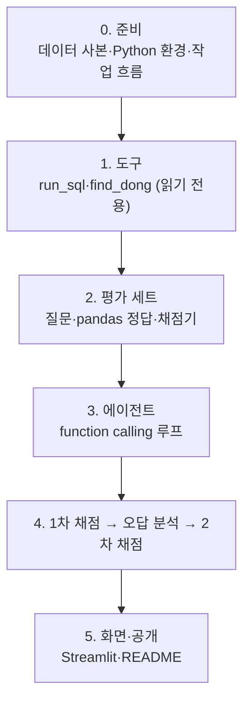

# 진행 과정 — 무엇을, 어떻게, 왜

프로젝트 전체를 처음부터 따라가는 **길잡이**다. 단계마다 무엇을 했고, 어떻게 했고, 왜 그렇게 했는지를 짧게 적고, 자세한 근거·대안·수치는 의사결정 문서(`docs/의사결정/`)로 연결한다.

- 현재 상태와 다음 작업: [`HANDOFF.md`](../HANDOFF.md)
- 날짜별로 한 일: [`docs/작업일지/`](작업일지/)
- AI가 한 일·내가 판단한 일·AI가 틀린 것: [`docs/AI_활용_기록.md`](AI_활용_기록.md)

## 한눈에 보기

## 먼저 알아 둘 말

| 말 | 뜻 |
|---|---|
| 에이전트 | LLM이 질문을 받고 **스스로 도구를 골라 실행**한 뒤, 그 결과를 보고 답하는 프로그램. 이 프로젝트에서는 도구 = 데이터 조회 함수 |
| function calling | LLM API 기능. 도구의 이름·설명·입력 형식을 알려 주면 LLM이 "이 도구를 이 인자로 불러 달라"는 요청을 돌려준다. 실행은 우리 코드가 하고 결과를 다시 LLM에 넘긴다 |
| 법정동 | 법으로 정한 동(예: 역삼동). 행정동(역삼1동)과 다르다. 데이터는 법정동 467개 |
| 대표점 | 동 안의 점 하나. 동에서 역까지 거리는 이 점에서 잰 직선거리다 |
| 정답률 | 질문 세트 중 에이전트 답이 코드로 계산한 정답과 맞은 비율 |

---

## 0. 준비 — 데이터·환경·작업 흐름

**무엇을**: 에이전트가 조회할 데이터를 고정하고, Python 환경과 작업 방식을 정했다.

**어떻게**
- 지하철 GIS 저장소의 공개 CSV 2개(법정동 467행, 역 389행)를 `data/`에 복사하고, SHA-256으로 원본과 같은지 확인했다
- Python 3.14로 `.venv`를 만들고, 설치된 버전으로 `requirements.txt`를 고정했다
- 작업 단위마다 브랜치 → PR, 사용자 판단이 필요한 지점에서 멈추고 의사결정 문서를 남기기로 했다
- 평가 질문 세트는 `eval/`, 도구 단위 테스트는 `tests/`로 나눴다(평가 데이터와 코드 테스트가 섞이지 않게)

**왜**
- 데이터를 고정해야 1차·2차 정답률을 같은 조건에서 비교할 수 있다
- 3.12를 쓸 근거가 없었고, 3.14에서 필요한 패키지가 모두 설치된다(사용자 질문으로 확인)

→ [1015_01 데이터 사본](의사결정/1015_01_데이터_사본.md) · [1015_02 Python 버전](의사결정/1015_02_Python_버전.md) · [1015_03 작업 흐름](의사결정/1015_03_작업_흐름.md)
