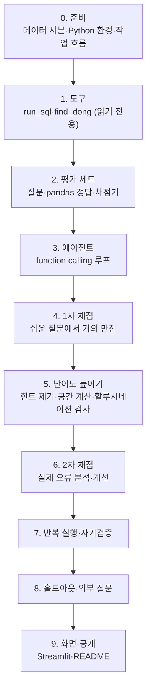

# 진행 과정 — 무엇을, 어떻게, 왜

프로젝트 전체를 처음부터 따라가는 **길잡이**다. 단계마다 무엇을 했고, 어떻게 했고, 왜 그렇게 했는지를 짧게 적고, 자세한 근거·대안·수치는 의사결정 문서(`docs/의사결정/`)로 연결한다.

- 현재 상태와 다음 작업: [`HANDOFF.md`](../HANDOFF.md)
- 날짜별로 한 일: [`docs/작업일지/`](작업일지/)
- AI가 한 일·내가 판단한 일·AI가 틀린 것: [`docs/AI_활용_기록.md`](AI_활용_기록.md)

## 한눈에 보기

## 먼저 알아 둘 말

| 말 | 뜻 |
|---|---|
| 에이전트 | LLM이 질문을 받고 **스스로 도구를 골라 실행**한 뒤, 그 결과를 보고 답하는 프로그램. 이 프로젝트에서는 도구 = 데이터 조회 함수 |
| function calling | LLM API 기능. 도구의 이름·설명·입력 형식을 알려 주면 LLM이 "이 도구를 이 인자로 불러 달라"는 요청을 돌려준다. 실행은 우리 코드가 하고 결과를 다시 LLM에 넘긴다 |
| 법정동 | 법으로 정한 동(예: 역삼동). 행정동(역삼1동)과 다르다. 데이터는 법정동 467개 |
| 대표점 | 동 안의 점 하나. 동에서 역까지 거리는 이 점에서 잰 직선거리다 |
| 정답률 | 질문 세트 중 에이전트 답이 코드로 계산한 정답과 맞은 비율 |

---

## 0. 준비 — 데이터·환경·작업 흐름

**무엇을**: 에이전트가 조회할 데이터를 고정하고, Python 환경과 작업 방식을 정했다.

**어떻게**
- 지하철 GIS 저장소의 공개 CSV 2개(법정동 467행, 역 389행)를 `data/`에 복사하고, SHA-256으로 원본과 같은지 확인했다
- Python 3.14로 `.venv`를 만들고, 설치된 버전으로 `requirements.txt`를 고정했다
- 작업 단위마다 브랜치 → PR, 사용자 판단이 필요한 지점에서 멈추고 의사결정 문서를 남기기로 했다
- 평가 질문 세트는 `eval/`, 도구 단위 테스트는 `tests/`로 나눴다(평가 데이터와 코드 테스트가 섞이지 않게)

**왜**
- 데이터를 고정해야 1차·2차 정답률을 같은 조건에서 비교할 수 있다
- 3.12를 쓸 근거가 없었고, 3.14에서 필요한 패키지가 모두 설치된다(사용자 질문으로 확인)

→ [1015_01 데이터 사본](의사결정/1015_01_데이터_사본.md) · [1015_02 Python 버전](의사결정/1015_02_Python_버전.md) · [1015_03 작업 흐름](의사결정/1015_03_작업_흐름.md)

## 1. 도구 — LLM이 데이터를 조회하는 통로

**무엇을**: LLM이 부를 수 있는 읽기 전용 함수 2개를 만들었다.

| 도구 | 하는 일 |
|---|---|
| `run_sql` | 표 `emd`(법정동)·`stations`(역)에 SELECT 하나 실행. 최대 200행, 5초 |
| `find_dong` | 동 이름 → 법정동 후보. 같은 이름이 여러 구에 있으면 모두, `역삼1동` 같은 행정동 표기는 `역삼동`으로 |

**어떻게**
- SQL은 DuckDB 파서로 "문장 1개, 종류 SELECT"인지 확인하고, 표를 올린 뒤 파일·네트워크 접근을 끈다
- 오류는 예외 대신 `{"error": ...}`로 돌려줘서 LLM이 고쳐 다시 시도할 수 있게 했다
- 도구 설명(`TOOL_SPECS`)에 열 이름·단위·동명 중복을 적었다. LLM은 이 설명만 보고 SQL을 짠다

**왜**
- 금지 단어 목록 방식은 주석·대소문자로 뚫린다. SELECT 안에서도 `read_csv()`로 파일을 읽을 수 있어 외부 접근 차단까지 해야 한다
- 같은 이름의 동은 신사동·신정동 2개였다. 로드맵에서 예로 든 관악구 신사동은 행정동이라 데이터에 없었다(데이터로 확인)

→ [1015_04 읽기 전용 도구](의사결정/1015_04_읽기전용_도구.md)

## 2. 평가 세트 — 정답을 코드로 계산하고 규칙으로 채점

**무엇을**: 질문 28개(7유형), pandas 정답, LLM 없는 채점기를 만들었다.

**어떻게**
- 질문 유형: 단일 동·구별 집계·순위·조건 필터·역·동명 중복·데이터에 없음
- 정답은 `src/answers.py`가 pandas로 계산한다. 에이전트(DuckDB SQL)와 다른 경로다. 정답 계산 자체는 원본 저장소에 적힌 값(중앙값 412m 등)과 대조했다
- 채점: 정답 글자가 답에 있는가, 정답 숫자가 허용 오차 안에 있는가, "데이터에 없다"고 했는가. 도구 선택은 따로 센다

**왜**
- 같은 코드로 정답과 답을 만들면 둘 다 틀려도 "맞음"이 된다
- LLM 판정은 판정 자체가 흔들리고 비용이 든다. 규칙 채점은 같은 답이면 항상 같은 결과다(대신 표현 차이에 약하다 — 1차 채점 후 오답을 보고 판단)

→ [1015_05 평가 세트와 채점](의사결정/1015_05_평가_세트와_채점.md)

## 3. 에이전트 — function calling 루프

**무엇을**: 질문 → 도구 호출 → 결과 → 답의 반복을 프레임워크 없이 직접 짰다(`src/agent.py`).

**어떻게**
1. 질문과 도구 설명을 Chat Completions 형식으로 보낸다(OpenAI 라이브러리로 Gemini 호환 주소를 부른다, [1015_07](의사결정/1015_07_Gemini_무료로_전환.md))
2. 모델이 도구 호출을 요청하면 우리 코드가 실행하고, 결과를 `tool_call_id`와 함께 돌려준다
3. 모델이 도구 호출 없이 글로 답하면 끝. 도구 호출은 6번까지, 넘으면 도구를 끄고 지금까지 결과로 답하게 한다
4. 매 호출의 입력·출력 토큰을 더해 비용을 계산한다

**왜**
- 루프가 20줄 남짓이라 면접에서 한 줄씩 설명할 수 있다. 프레임워크를 쓰면 이 부분이 감춰진다
- 실제 API 없이 가짜 클라이언트로 루프를 테스트했다(도구 결과 전달, 오류 전달, 호출 상한)

`src/eval.py`가 질문 세트를 한 번에 돌려 `outputs/eval_report_<이름>.md`를 쓴다. 답·도구 호출 원본은 `outputs/raw/`(비공개)에 남긴다.

## 4. 1차 채점 — 쉬운 질문에서 거의 만점, 그래서 질문을 어렵게

**무엇을**: 개선용 질문으로 에이전트를 채점하고, 결과를 보고 채점 규칙과 질문 세트를 고쳤다.

**어떻게**
- 모델은 gemini-3.5-flash-lite(무료 등급). OpenAI는 API 크레딧이 없어 Gemini로 바꿨다([1015_07](의사결정/1015_07_Gemini_무료로_전환.md))
- run1(28문항): 27/28. 유일한 오답 Q28은 "데이터에 도보 시간은 없습니다"라는 맞는 답을 거절 규칙이 못 알아본 판정 오류였다 → 규칙을 고치고, API 호출 없이 저장된 답을 다시 채점해 28/28
- 질문이 대부분 SQL 한 번으로 끝나 에이전트의 판단력을 재지 못했다 → 여러 단계·표 결합·이어지는 대화 유형을 개선용·홀드아웃 양쪽에 추가(100문항)
- run1b(40문항): **40/40**, 요청 87회, 실제 비용 0(유료 환산 $0.031)

**왜**
- 결과를 본 뒤 채점 기준을 바꾸면 점수를 맞추려는 것으로 보일 수 있다. 그래서 "답 내용이 맞았다"는 근거와, 너무 느슨해지지 않았는지 막는 테스트를 같이 남겼다
- 홀드아웃은 아직 한 번도 돌리지 않았으므로 지금 세트를 바꿔도 홀드아웃의 의미가 깨지지 않는다

→ [1015_08 채점 수정과 어려운 문항](의사결정/1015_08_채점_수정과_어려운_문항.md)

## 5. 난이도 높이기 — 만점인 시험은 자로 쓸 수 없다

**무엇을**: 개선용 세트가 만점이라 개선 전후를 잴 수 없었다. 원인을 찾아 평가를 어렵게 하고, 할루시네이션을 코드로 재는 지표를 만들었다.

**어떻게**
1. 만점 원인을 정리했다: 출제자와 답 준비자가 같음(프롬프트에 함정의 답), 질문이 열 설명 말투, 도구가 표 조회뿐, 1회 실행, 너그러운 채점. 데이터 행 수는 주원인이 아니다(에이전트는 행을 읽지 않고 표 구조로 SQL을 짠다)
2. **힌트 제거** → 같은 40문항 다시: 40/40. 힌트가 점수를 만든 것은 아니었다
3. **공간 계산** `dist_m`(하버사인 SQL 매크로) 추가 → 좌표로 거리를 새로 재야 하는 질문 추가. run3(44문항) 공간 4문항 모두 정답. 원본의 가장 가까운 역 467개를 이 공식으로 다시 만들어 공식을 검증했다
4. run3 오답 2개가 다시 거절 판정 문제 → 거절을 문장 단위로 판정, 홀드아웃 전에 확정
5. **근거 검사**: 답의 숫자가 도구 결과에 있는지 자동 대조. 지어낸 사실 0, 모델이 직접 계산한 값 1건(Q29) → 시스템 프롬프트에 "계산도 SQL로" 추가
6. **지어내기 유혹 문항**: 걷는 시간·출구 번호·집값처럼 추정하고 싶어지는 질문, "역이 10개나 있다던데 맞아?" 같은 틀린 전제, 없는 동

**왜**
- 결과를 보고 기준을 바꿀 때마다 근거(답 내용이 맞았음)와 너무 느슨해지지 않게 막는 테스트를 같이 남겼다. 홀드아웃 전에 규칙을 확정한다
- 할루시네이션은 "없어 보인다"가 아니라 숫자로 재야 개선 전후를 말할 수 있다

→ [1015_09 난이도 높이기](의사결정/1015_09_난이도_높이기.md) · [1015_10 할루시네이션 측정과 억제](의사결정/1015_10_할루시네이션_측정과_억제.md)

## 6. 2차 채점 — 처음으로 나온 실제 오류와 개선

**무엇을**: 할루시네이션 대응(1015_10)을 넣고 개선용 48문항을 돌려, 처음으로 나온 에이전트의 실제 오류를 고쳤다.

**어떻게**
- run4: 47/48, 근거 없는 수치 0/48. "계산도 SQL로"가 효과를 냈다(Q29를 SQL로 계산)
- 오류 1(Q47): 없는 동 청담1가를 청담동으로 말없이 바꿔 답함 → 프롬프트 규칙 + `find_dong`이 비슷한 동을 "같은 동이 아님"으로 따로 알려 줌
- 오류 2(Q45): 계산할 수 있는 강남역 거리를 "데이터에 없다"고 함(채점은 통과, 답을 읽어 발견) → 거리는 계산해서 알려 주라는 규칙
- 고친 뒤 오류 3(Q45): 계산한 거리를 "분당 80m로 13분"으로 환산 → 근거 검사와 `absent`가 잡음 → 가정 환산 금지 규칙. 다시 실행 6/6

**왜**
- 한 가지를 고치면 다른 곳이 깨진다. 그래서 고친 뒤 관련 문항을 다시 돌렸고, 개선용 전체도 다시 돌린다
- 규칙 채점이 놓친 오류(오류 2)도 있어서, 점수와 함께 답을 직접 읽는 검토를 한다

→ [1015_11 run4 오류 분석과 개선](의사결정/1015_11_run4_오류_분석과_개선.md)

## 7. 반복 실행 — 같은 질문을 3번

**무엇을**: 1015_11 규칙을 넣은 상태로 개선용 48문항을 3번 돌렸다(run5a·b·c).

**어떻게**
- 3번 모두 48/48. 새 규칙 때문에 다른 문항이 깨지지 않았다
- 근거 없는 수치 0·1·0. run5b Q48은 도구를 부르지 않고 "고속터미널역 669m"(실제 208m)를 지어냈다. 정답 판정은 통과했고 근거 검사가 잡았다
- 답 문장은 실행마다 다르다(3번 모두 같은 글자인 답 5/48)

**왜**
- 한 번만 돌렸다면 지어낸 답을 못 봤거나, 그것만 봤을 수 있다
- 정답률만 보면 3번 모두 완벽하다. 그래서 정답률과 근거 없는 수치를 따로 센다

→ [1015_11 run4 오류 분석과 개선](의사결정/1015_11_run4_오류_분석과_개선.md)

### 자기검증 단계

**무엇을**: 답의 숫자가 도구 결과에 없으면 코드가 그 숫자를 알려 주고 1번만 다시 답하게 했다. 프롬프트 규칙이 있어도 지어낸 답(run5b Q48)이 나왔기 때문이다.

**어떻게**
- 검사기가 걸러서 생긴 0을 모델의 정직함으로 내세우지 않으려고, 검증 전 첫 답과 검증 후 최종 답을 둘 다 채점하고 개입 횟수를 적는다
- run6_check: 48/48, 근거 없는 수치 첫 답 2/48 → 최종 0/48. 개입 2회 중 1회(Q11)는 도구 설명에 있는 숫자를 잡은 오탐이었다

**왜**
- 실제 서비스에서는 가끔 지어내는 답을 그대로 내보낼 수 없다. 부탁(프롬프트)보다 확인(코드)이 확실하다
- 다만 검사 기준이 평가와 같아서, 최종 답 수치만으로는 개선을 말하지 않는다

→ [1015_12 자기검증 단계](의사결정/1015_12_자기검증_단계.md)

## 8. 홀드아웃과 외부 질문

**무엇을**: 개선 때 보지 않은 질문으로 마지막에 한 번 쟀다. 직접 만든 홀드아웃 72문항과, 데이터 구조를 모르는 다른 AI(ChatGPT 무료)가 쓴 질문 30문항이다.

**어떻게**
- 다른 AI에게는 파일·웹 접근을 막고 데이터를 평범한 말로만 설명했다. 받은 질문은 고치지 않았고, 기준이 애매한 10문항은 정답률에서 뺐다
- 정답 규칙은 실행 전에 커밋했다. 결과를 보고 채점을 맞추지 않았다는 증거다
- 결과: 홀드아웃 71/72, 외부 AI 질문 16/20. 근거 없는 수치는 최종 답 기준 모두 0
- 오답과 기준 애매 답, 정답 일부를 사람이 읽었다. 채점 규칙이 놓친 맞는 답 1개(A27)는 점수를 고치지 않고 따로 적었다

**왜**
- 같은 사람이 만든 홀드아웃은 개선 방향과 같은 생각으로 만들어져 성능을 높게 보이게 한다(99%). 다른 출제자의 질문은 생각하지 못한 오류(여러 값이 든 열, 표현을 바꾼 가정 환산)를 드러냈다(80%)
- 실제 사용자 질문의 1/3은 기준이 애매했다. 정답이 하나인 질문만으로는 실제 사용을 다 재지 못한다

- 오류를 보고 도구 설명을 고친 뒤(여러 값 열 안내), 같은 방식으로 새 질문 50개를 받아 다시 쟀다: 자동 채점 21/21. 노선을 나눠 쓰는 SQL이 늘었다. 사람이 읽은 답에서는 숫자 없이 틀린 결론을 단정한 답이 나왔다 — 숫자를 보는 근거 검사로는 못 잡는 종류다

→ [1016_01 외부 AI 질문 세트](의사결정/1016_01_외부_AI_질문_세트.md) · [1016_02 홀드아웃 결과와 분석](의사결정/1016_02_홀드아웃_결과와_분석.md) · [1016_03 여러 값 열 안내](의사결정/1016_03_여러_값_열_안내와_근거_검사_유지.md) · [1016_04 외부 AI 질문 2차](의사결정/1016_04_외부_AI_질문_2차.md)

