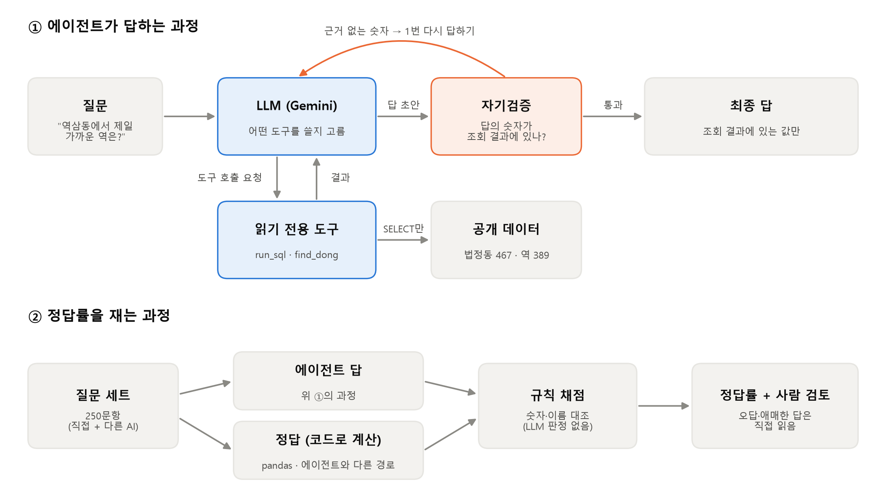
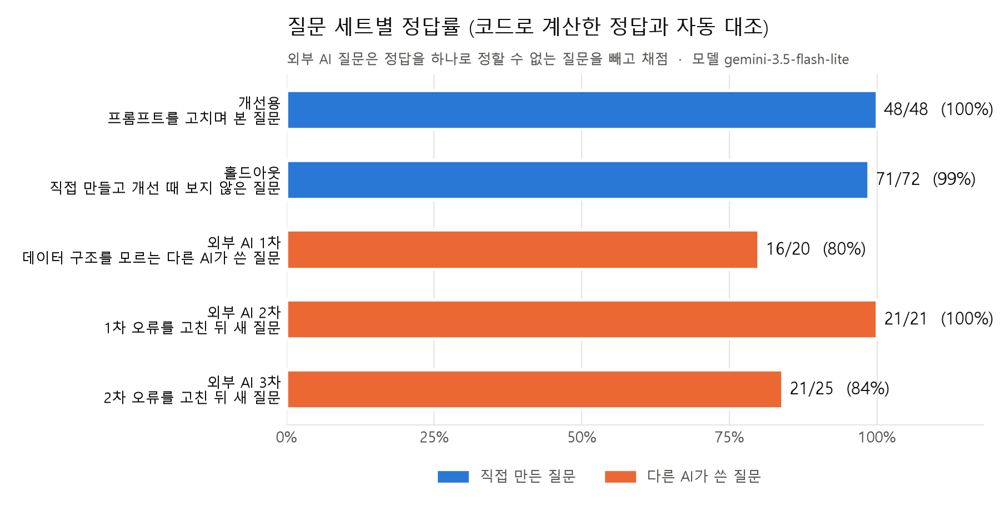
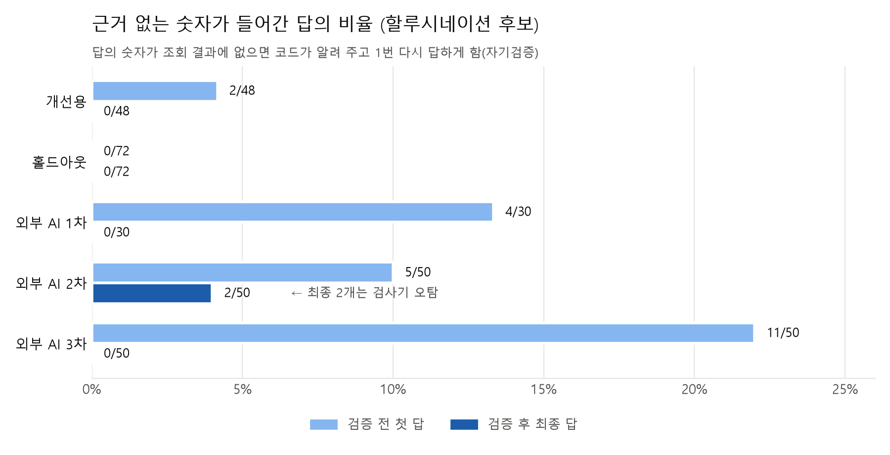

# 포트폴리오 요약 — 서울 지하철 접근성 GIS 질의 에이전트

> 포트폴리오·이력서에 옮겨 쓰기 위한 한 장 요약입니다. 자세한 내용은 [README](../README.md)와 [진행 과정](진행_과정.md)에 있습니다.

| 항목 | 내용 |
|---|---|
| 기간 | 2026-10-14 ～ 2026-10-17 (4일), 1인 |
| 한 줄 소개 | 자연어 질문을 받아 AI가 직접 데이터를 조회하고 그 결과로만 답하는 GIS 챗봇, 그리고 정답률을 자동으로 재는 평가 장치 |
| 기술 | Python 3.14, Gemini API(OpenAI 호환 Chat Completions), function calling, DuckDB, pandas, Streamlit, pytest |
| 데이터 | 직접 만든 공개 GIS 데이터: 서울 법정동 467개·지하철역 389개의 접근성 지표 |
| 저장소 | https://github.com/KimInSeok-DA/DA_GIS_Query_Agent |

## 1. 풀려고 한 문제

AI 챗봇은 데이터에 없는 숫자도 그럴듯하게 말합니다. 그래서 **"잘 답한다"를 느낌이 아니라 숫자로 증명**하는 것을 목표로 잡았습니다.
- AI는 조회 결과에 있는 값만 말해야 한다
- 정답률을 사람이 아닌 코드로, 같은 기준으로 반복해서 잴 수 있어야 한다
- 틀린 답이 나오면 원인을 찾아 고치고, 고친 효과를 다시 잴 수 있어야 한다

## 2. 만든 것

- **에이전트 루프를 프레임워크 없이 직접 구현**: 질문 → AI가 도구 선택 → 우리 코드가 실행 → 결과를 AI에 돌려줌 → 답. 도구 호출은 6번까지
- **읽기 전용 도구 2개**: `run_sql`(SELECT 한 문장만, 최대 200행·5초, 파일·네트워크 접근 차단, 좌표 거리 함수 `dist_m`), `find_dong`(동 이름 → 법정동, 같은 이름의 동은 모두 반환)
- **자기검증**: 답의 숫자가 조회 결과에 없으면 코드가 알려 주고 1번 다시 답하게 함
- **평가 장치**: 질문 250개, 정답은 에이전트와 다른 경로(pandas)로 계산, 채점은 규칙 기반(AI 판정 없음)
- **화면**: Streamlit으로 질문·답과 함께 AI가 실행한 SQL·결과·비용을 보여 줌
- 테스트 136개(API 호출 없이 가짜 클라이언트로 루프 검증)

## 3. 결과

| 질문 세트 | 정답률 | 근거 없는 숫자 (검증 전 → 최종) |
|---|---|---|
| 홀드아웃 (직접 만들고 개선 때 보지 않은 질문) | **71/72 (99%)** | 0 → 0 |
| 외부 AI 질문 1·2·3차 (다른 AI가 쓴 질문) | 16/20 · 21/21 · 21/25 | 4 · 5 · 11 → 0 · 2(오탐) · 0 |

- 무료 등급 모델로 실제 비용 0원, 유료로 환산하면 50문항 한 번에 약 $0.13～0.15

## 4. 문제를 해결한 과정 (대표 사례 3개)

**① 만점이 나와서 오히려 시험을 어렵게 바꿨다**
- 상황: 첫 평가에서 40/40 만점. 이대로는 개선 전후를 비교할 수 없었다
- 원인 분석: 후보를 하나씩 확인했다. 지시문에 들어 있던 힌트를 빼도 40/40이라 힌트 때문은 아니었다. 질문 대부분이 조회 한 번으로 끝나는 쉬운 질문이었다
- 조치: 좌표로 거리를 새로 계산해야 하는 질문, 지어내고 싶어지는 질문(걷는 시간·집값·틀린 전제)을 추가하고, 답의 숫자를 조회 결과와 대조하는 검사를 만듦
- 결과: 처음으로 실제 오류가 드러났고(47/48), 이를 고쳐 48/48

**② 출제자를 바꾸자 숨은 오류가 나왔다**
- 상황: 직접 만든 홀드아웃은 99%였지만, 데이터 구조를 모르는 다른 AI가 쓴 질문에서는 80%
- 원인: "운영기관" 칸에 여러 회사가 한 줄로 들어 있는데 나누지 않고 셈. "걸어서 5분"을 400m로 마음대로 환산
- 조치: 도구 설명에 여러 값이 든 칸을 나눠 쓰라고 안내, 가정으로 환산하지 말라는 규칙
- 결과: 새 질문 50개(2차)에서 자동 채점 21/21, 칸을 나눠 쓰는 SQL이 0개 → 9개

**③ 지어낸 숫자를 코드로 잡았다**
- 상황: 같은 질문을 3번 돌렸더니 한 번은 AI가 조회 없이 "고속터미널역 669m"라고 답함(실제 208m). 채점은 통과
- 판단: 지시문으로 부탁하는 것만으로는 막을 수 없다. 코드로 확인해야 한다
- 조치: 답의 숫자가 조회 결과에 없으면 다시 답하게 하는 자기검증 단계. 검사기 덕분에 생긴 0을 AI의 정직함으로 포장하지 않도록 검증 전 수치도 함께 기록
- 결과: 근거 없는 숫자가 최종 답에서 0(외부 3차: 검증 전 11/50 → 최종 0/50)
- 부작용도 기록: 외부 질문 1～3차를 합치면 고친 답과 다시 쓰다 나빠진 답의 수가 비슷했다(예: 3차 C23은 다시 쓰면서 "총 49개"가 빠짐). 다음 개선 후보로 "틀린 숫자만 고치고 나머지는 유지"하는 메시지를 정리해 둠

## 5. 평가를 공정하게 하려고 지킨 것

- **정답은 AI와 다른 경로로 계산**: 같은 코드로 정답과 답을 만들면 둘 다 틀려도 "맞음"이 된다
- **채점 규칙은 실행 전에 커밋**: 결과를 보고 채점을 유리하게 바꾸지 않았다는 증거를 Git 기록으로 남김
- **틀린 답은 사람이 읽음**: 채점 규칙이 맞는 답을 틀렸다고 한 경우도 점수는 고치지 않고 따로 적음
- **실제 실행 결과만 기록**: 정답률·호출 수·비용은 모두 실행 로그에서 집계

## 6. 한계와 다음 단계

- 질문 수가 적고(1문항이 4～5%p), 외부 질문도 AI가 썼다
- 자동 검사는 숫자만 보며, 숫자 없는 틀린 결론은 사람 검토로만 찾았다
- 남은 약점: 동점 처리(1위가 여러 곳인데 하나만 답함). 다음 개선 후보로 정리해 둠
